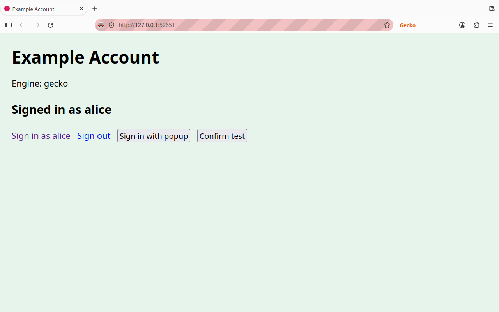
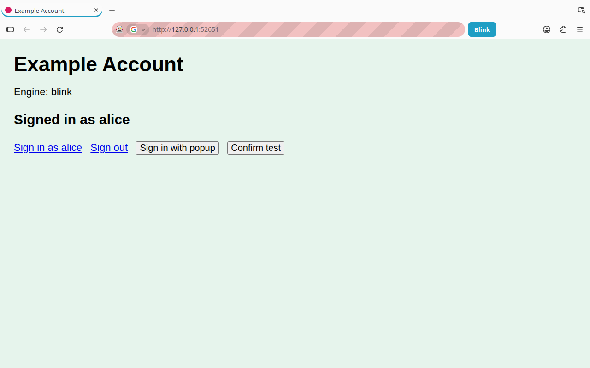
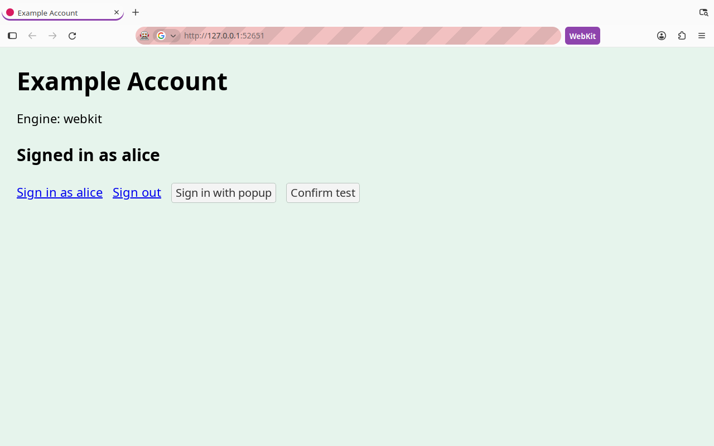
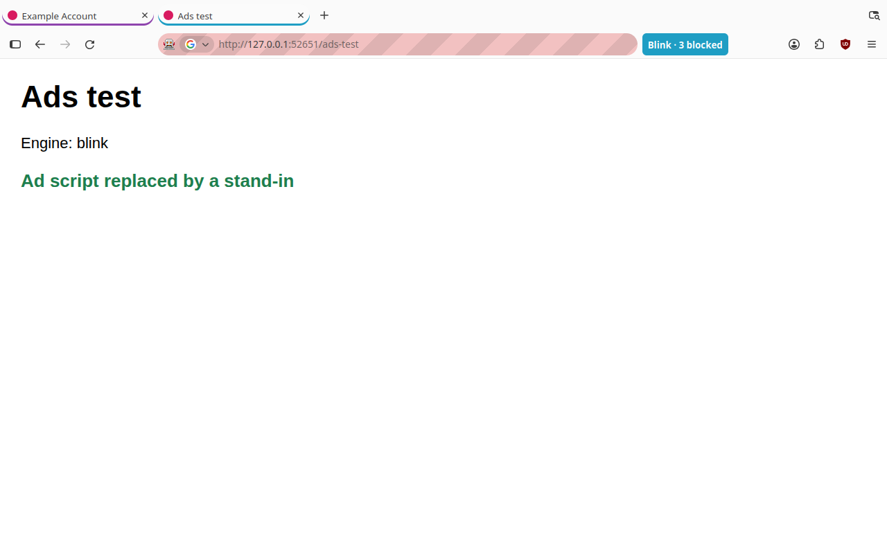
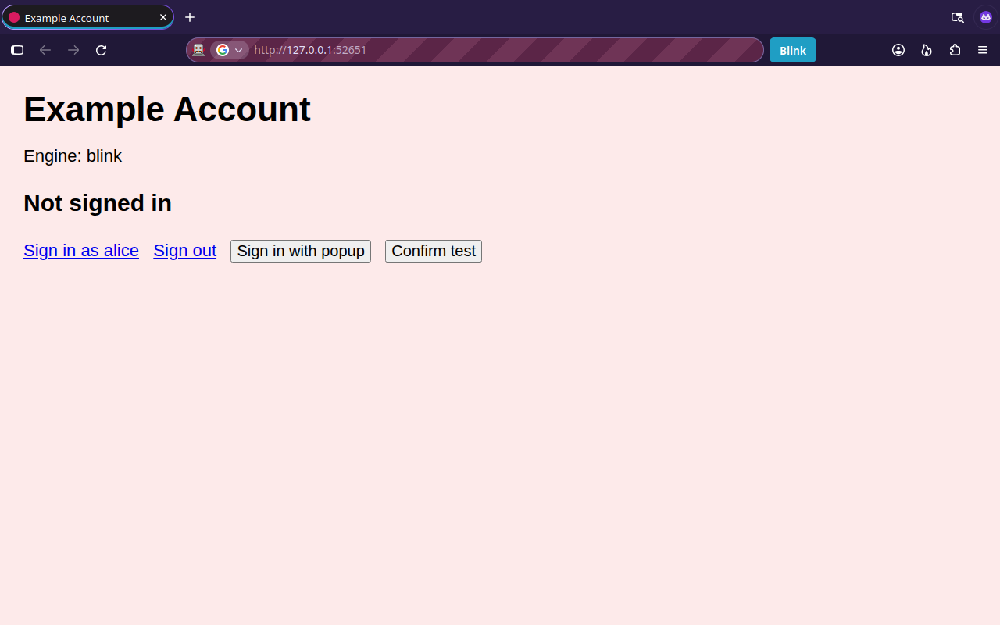

# HybridFox

[](https://github.com/ayastaga/hybridfox/actions/workflows/ci.yml)

One browser window, three engines. Every tab runs on Firefox's engine (Gecko)
by default, and any tab can switch to Chromium's engine (Blink) or WebKit and
back, inside the same window and tab strip, keeping your sign-ins.

This is a prototype: real engines, hand-made glue. It runs an unmodified,
official Firefox build, Chromium 156 through CEF (the Chromium Embedded
Framework) and WebKit through WebKitGTK. Nothing is compiled from Firefox's,
Chromium's or WebKit's source. The exact builds are pinned, with checksums,
in [`versions.json`](versions.json).

What the claims below rest on: each names the automated tests that check it
(in [`tests/`](tests/), run in CI and under `xvfb-run`), or says it is
untested. See [What's tested](#whats-tested) for the full list, and
[docs/benchmarks.md](docs/benchmarks.md) for measured costs.


| Gecko | Blink | WebKit |
| --- | --- | --- |
|  |  |  |

| uBlock Origin in a Blink tab | A private window |
| --- | --- |
|  |  |

These come from a scripted run under Xvfb
([`scripts/screenshots.py`](scripts/screenshots.py)); the striped address
bar is Firefox's sign that a script is driving it.

## Requirements

- x86_64 or ARM64 (aarch64) Linux, any desktop. On Wayland (GNOME, KDE) it
  runs through XWayland, which those desktops start automatically.
- About 4 GB of disk.
- Build tools: `curl xz bzip2 python3 cmake g++ make` and the X11 headers.
- Optional, for the WebKit engine: WebKitGTK's development files. Setup
  builds the WebKit engine when they're present and says how to add them
  otherwise.

```bash
# Debian/Ubuntu
sudo apt install curl xz-utils bzip2 python3 cmake g++ make libx11-dev
sudo apt install libwebkit2gtk-4.1-dev libjson-glib-dev libsoup-3.0-dev pkg-config  # WebKit
# Fedora
sudo dnf install curl xz bzip2 python3 cmake gcc-c++ make libX11-devel
# Arch
sudo pacman -S --needed curl xz bzip2 python cmake gcc make libx11
```

Tested on Ubuntu 26.04 (aarch64) and, in CI, Ubuntu 24.04 (x86_64). Fedora
and Arch package names are given but those systems are untested.

## Build and run

```bash
./setup.sh          # downloads the pinned Firefox + CEF, builds the engines (~10 min)
./hybridfox         # starts the browser
```

`./hybridfox --debug` also prints every message between Firefox and the
engines to the terminal. `./setup.sh --update` moves the pins in
`versions.json` to the latest Firefox and CEF releases, downloads and checks
them, and rebuilds.

Your profile lives in `~/.local/share/hybridfox/`, separate from your normal
Firefox and Chrome profiles. (Earlier versions, called "Hybrid Browser", used
`~/.local/share/hybrid-browser/`; the launcher moves it the first time.
Test: `test_old_profile_folder_is_migrated`.)

### Installing as a .deb (Debian, Ubuntu)

After `./setup.sh`, you can package your build and install it like any app:

```bash
./make-deb.sh                     # maintainer: $MAINTAINER, or your git name and email
sudo apt install ./hybridfox_*.deb
hybridfox
```

The package installs to `/opt/hybridfox`, adds a *HybridFox* entry to your
app menu and turns on Chromium's sandbox during installation. It's built for
your machine's processor and is about 400 MB. Remove it with
`sudo apt remove hybridfox`. It bundles an official, Firefox-branded build,
so it is for your own machines: read
[THIRD_PARTY_NOTICES.md](THIRD_PARTY_NOTICES.md) before sharing it.

### Chromium's sandbox

Chromium's sandbox needs unprivileged user namespaces. Ubuntu 23.10 and later
restrict them, and the launcher then warns that Chromium tabs run without the
sandbox. To enable it, run once (paths are printed in the warning):

```bash
sudo chown root:root engine/build/out/chrome-sandbox
sudo chmod 4755 engine/build/out/chrome-sandbox
```

The automated tests run without the sandbox (`HYBRID_NO_SANDBOX=1`): CI
runners restrict user namespaces too.

## Using it

- **Switch the current tab's engine:** click the engine button next to the
  address bar (**Gecko**, **Blink** or **WebKit**) and pick an engine, or press
  **Ctrl+Alt+E** to cycle Gecko → Blink → WebKit. The page reloads in the
  chosen engine.
- **Switch any tab:** right-click it and use *Tab Engine*.
- **Open a link with another engine:** right-click the link and choose *Open
  Link in New Blink Tab* or *Open Link in New WebKit Tab*.
- Blink tabs have a blue underline in the tab strip, WebKit tabs a purple one.

Switching itself is tested (`test_one_tab_through_three_engines_stays_signed_in`);
the menus, context-menu items and the Ctrl+Alt+E shortcut are not.

**You stay signed in across engines.** All engines share one cookie jar:
sign in on any engine and the others are signed in too, even tabs that are
already open, and signing out works the same way.
*Tests:* `test_one_tab_through_three_engines_stays_signed_in`,
`test_webkit_sign_in_reaches_new_blink_tab`,
`test_live_sign_out_relays_from_blink_to_webkit`,
`test_samesite_only_change_*`, `test_engine_cookie_expiry_units`.

**Popups and dialogs.** Sign-in popups keep their connection to the page
that opened them, and alert, confirm and prompt dialogs work in engine tabs
(they appear as Firefox's own prompts).
*Tests:* `test_popup_keeps_opener_and_closes_itself`, `test_dialog_round_trip`
(engine side, both engines). Untested: the Firefox prompt itself.

**Every window, including private windows.** Engine tabs work in all
windows. In a private window they use a separate in-memory profile that
shares sign-ins only with that private session and is discarded, together
with Firefox's private data, when the last private window closes.
*Tests:* `test_private_window_isolation_and_discard`,
`test_private_end_discards_private_profile`.

**Your Firefox extensions filter Chromium tabs' requests.** Extensions that
block or redirect requests decide the requests a Chromium tab's pages make,
with their own lists and your settings: blocked requests are cancelled, and
stand-ins an extension substitutes (uBlock Origin's harmless replacement
scripts) are served to the page. This works because the blank Gecko page
under each Chromium tab takes on the site's identity and asks for each
request from there, so extensions see an ordinary Firefox request; nothing
is downloaded twice. What is and isn't covered, measured with uBlock Origin,
ClearURLs and Privacy Badger, is in
[docs/extension-bridge.md](docs/extension-bridge.md).
*Tests:* `test_ublock_origin_filters_blink_tab`,
`test_placeholder_takes_site_identity`, `test_substituted_body_is_served`,
`test_redirect_verdict_is_followed`. WebKit tabs aren't filtered by
extensions (see Known limits).

**Firefox's protections apply to Chromium tabs.** Before a Chromium tab
loads a page, Firefox checks it with Safe Browsing; a phishing or malware
page opens in Gecko instead, showing Firefox's own warning. Third-party
requests from Chromium pages are checked against Firefox's Enhanced Tracking
Protection lists, following your protection level, its private-window
setting and your per-site exceptions. The engine button shows how many
requests were blocked ("Blink · 3 blocked"). If Firefox doesn't answer a
check within 1.5 s, the request is blocked ("fail closed"), except page
loads, which go ahead so a stall can't stop browsing; `HYBRID_FAIL_OPEN=1`
allows both.
*Tests:* `test_safe_browsing_sends_unsafe_page_to_gecko`,
`test_tracking_protection_blocks_trackers_in_blink`,
`test_resource_without_verdict_is_blocked`, `test_no_verdict_is_never_cached`,
`test_fail_open_env_restores_old_behaviour`,
`test_every_subresource_is_checked`,
`test_subresource_of_non_web_page_is_checked`. Untested: protection levels
other than the tracking-protection pref, private-window settings and
per-site exceptions.

**No Chromium traces on disk.** Chromium's working folder lives in a
temporary folder in memory (`$XDG_RUNTIME_DIR`) and is deleted when the
browser closes. Sign-ins come from Firefox's cookie jar, and pages you visit
in engine tabs are recorded in Firefox's history (except in private
windows). Set `HYBRID_CHROMIUM_PERSIST=1` to keep a Chromium profile instead.
*Tests:* `test_no_chromium_profile_left_on_disk`,
`test_engine_visits_go_to_firefox_history`.

**Per-site rules.** Right-click a tab and choose *Always Open example.com
with…*; visits to that site then open with that engine. When a page in a
Gecko tab says it doesn't support your browser, a bar offers to open it in
Chromium, once or always. Rules can't be created from private windows,
since that would record a site you visited privately.
*Tests:* `test_site_rule_opens_site_in_its_engine`,
`test_refusal_bar_offers_chromium`, `test_private_window_isolation_and_discard`.

**Crash recovery.** If an engine's process crashes, it is restarted and its
tabs reopen where they were, still signed in. After 3 crashes in 2 minutes
it is left stopped, and the engine button says so ("Blink · stopped").
*Tests:* `test_engine_crash_reopens_tabs`,
`test_engine_gives_up_after_three_crashes`.

**Same size as Gecko tabs.** Engines render at Firefox's scale, and
Ctrl+Plus, Ctrl+Minus and Ctrl+0 zoom engine pages using Firefox's zoom
steps (the engine button shows the level, e.g. "Blink 110%").
*Tests:* `test_engine_zoom_uses_firefox_steps`,
`test_zoom_resizes_red_square`. Untested: HiDPI and fractional scales (the
tests run at scale 1).

Inside an engine tab, the address bar, bookmarks, search, back, forward and
reload (including F5 and Ctrl+R) act on the engine's page. Ctrl+T, Ctrl+W,
Ctrl+L, Ctrl+N, Ctrl+Tab, Ctrl+Shift+Tab, Ctrl+PageUp/PageDown, Ctrl+Shift+T
and F6 work while an engine page has the keyboard. Engine tabs reopen in
their engine after a restart. *Untested* (only keyboard focus handover is:
`test_unfocus_hands_keyboard_to_focus_proxy`).

## How it works

```
 Firefox (official build)                      chromium-host (CEF 156)
 ┌───────────────────────────────────┐ stdin   ┌──────────────────────────┐
 │ hybrid.cfg   loads ──► hybrid-    │ ──────► │ one CEF browser per      │
 │ (autoconfig)          browser.js  │ JSON    │ Chromium tab             │
 │                                   │ ◄────── │ title/url/loading/keys   │
 │ tab strip, address bar, menus     │ stdout  │                          │
 └──────────────┬────────────────────┘         └────────────┬─────────────┘
                │ X11 window                                │ X11 child windows
                └──────────── Chromium views are placed over the tab's content area
```

- **Shell (`shell/`).** Firefox runs `hybrid.cfg` at startup through its
  built-in autoconfig mechanism. That loads `hybrid-browser.js` into each
  browser window. A Chromium tab is a normal Firefox tab whose Gecko page
  sits on `about:blank` while a Chromium view covers its content area. The
  script maps Firefox's tab strip, address bar, navigation buttons, menus,
  keyboard shortcuts and session restore onto Chromium.
- **Engine (`engine/chromium_host.cc`).** A C++ program on CEF. Firefox
  starts it as a helper process and sends it one JSON command per line
  (create, show, hide, move, navigate, back, forward, reload, focus, close).
  It answers with events (title, URL, loading state, favicons, popups and
  browser shortcuts pressed inside a Chromium page).
- **Embedding.** Each Chromium tab is an X11 child window inside Firefox's
  window, so it moves, resizes and stacks with Firefox natively. Each one
  lives in a small container window with the default X11 visual, because
  Firefox's window uses a different visual that Chromium's window can't
  inherit.
- **Shared cookie jar.** Firefox's cookie jar is the master copy. At startup
  Chromium's jar is replaced with it; after that every cookie Firefox adds,
  changes or deletes is pushed to Chromium immediately, and the engine
  compares Chromium's jar with Firefox's every second and sends back any
  differences (CEF has no change notification). Switching a tab from Chromium
  to Gecko syncs first, so the page reloads already signed in. Each side
  ignores changes it just received, so nothing bounces back and forth.
- **What "the same cookie" means.** A cookie is mirrored again whenever
  its value, Secure, HttpOnly, session/expiry or SameSite attribute
  changes, so a site that only tightens a cookie to `SameSite=Strict` is
  seen by every engine.
- **Popups.** A popup opened by a Chromium page stays a real Chromium popup,
  so it can still talk to the page that opened it (sign-in popups depend on
  this), and it appears as a new tab. When it closes itself, its tab closes.
- **Keyboard focus.** The window manager only sees Firefox's window, so the
  host watches mouse clicks. A click on a Chromium view gives it the
  keyboard, and a click anywhere else hands it back to Firefox through GTK's
  focus window.
- **WebKit** (`engine/webkit_host.c`) speaks the same protocol, with a
  WebKitGTK web view in a GtkPlug per tab.
- **Crashes.** HybridHost tells an engine exit it asked for (quitting) from
  a crash, restarts a crashed engine and has each window reopen that
  engine's tabs with the same ids.

### Cookies that stay in Firefox

Firefox keeps some cookies apart on purpose, and the engines have only one
plain jar per profile ("normal" or "private"), with no way to keep them
apart. Mirroring them would undo the isolation, so they stay in Gecko:

- **Container tabs** (Multi-Account Containers, `userContextId`): each
  container is a separate identity. Mirroring would merge every container
  into one engine jar, so a site would see your work and personal accounts
  as the same person.
- **Partitioned third-party cookies** (Total Cookie Protection, CHIPS;
  `partitionKey`): a tracker's cookie set under `news.example` is stored
  separately from the same tracker's cookie under `shop.example`, so it
  can't follow you between sites. The engines' jars aren't partitioned by
  top-level site, so a mirrored copy would be readable everywhere.
- **First-party isolation** (`privacy.firstparty.isolate`,
  `firstPartyDomain`): the older form of the same idea, with the same
  problem.

The cost: a sign-in that lives only in a container, or a third-party
embed's partitioned cookie, isn't carried into engine tabs. Sign-ins made
in normal (and private) tabs are.

## Running the tests

The tests need an X server; `xvfb-run` provides a virtual one.

```bash
sudo apt install xvfb python3-xlib python3-pytest   # Debian/Ubuntu
./setup.sh                                          # build first
python3 scripts/deps.py fetch-test-addons           # uBlock Origin, for one test
xvfb-run -a -s "-screen 0 1280x1024x24" python3 -m pytest -v tests/
```

- `tests/test_engine_protocol.py` drives each engine host directly
  through its line protocol, with a stand-in for Firefox's window (an X11
  window with Firefox's non-default visual), synthetic clicks (XTEST) and
  pixels read back from the X server.
- `tests/test_browser.py` drives the real browser through Marionette
  (Firefox's remote-control protocol). It starts `./hybridfox` with a
  temporary profile and `HYBRID_TEST=1`, which adds a small
  `window.HybridTest` hook for the tests.
- `tests/test_deps.py` checks the pinned downloads offline;
  `tests/test_repo.py` checks for mistakes that were made once.

Results are checked through `tests/signin_site.py`, a small local site
that records every request it serves (`/_log`): which engine asked (from
the User-Agent) and who was signed in. Logs of each test's engine and
browser output land in `tests/artifacts/`.

To try sign-ins by hand:

```bash
python3 tests/signin_site.py &      # http://127.0.0.1:8765
./hybridfox http://127.0.0.1:8765/
```

`tests/chromium-only-test.html` shows features that work in Chromium but
not in Firefox.

## What's tested

Every run of the suite (CI on each push, Ubuntu 24.04 x86_64; and Ubuntu
26.04 aarch64 under `xvfb-run`) covers:

- **Each engine host on its own** (`tests/test_engine_protocol.py`, Blink
  and WebKit): attaching to a window with Firefox's non-default visual,
  rendering, zoom, cookies in and out (including SameSite-only changes),
  popups that keep `window.opener`, dialogs, private-profile discard, focus
  handover, clean exit; for Blink also fail-closed checks, substituted and
  redirected responses, and that every subresource is checked.
- **The whole browser** (`tests/test_browser.py`, through Marionette):
  sign-ins across all three engines and between open tabs, private
  windows, site rules, the refusal bar, crash recovery, Safe Browsing and
  tracking protection in Blink tabs, uBlock Origin filtering a Blink tab,
  history, zoom, the placeholder page's identity, profile migration, and
  that no Chromium folder is left on disk.
- **Downloads** (`tests/test_deps.py`): checksums enforced, pins respected.
- **Past mistakes** (`tests/test_repo.py`), such as the engine's library
  search path.

Not tested automatically: HiDPI and fractional scaling, Wayland/XWayland
on a real desktop, a window manager (the tests run without one), keyboard
shortcuts inside engine tabs, the engine menus and context menus, session
restore, dragging tabs between windows, Firefox's prompt for engine
dialogs, the `.deb` package, Chromium's sandbox, WebKit crash recovery,
and Fedora or Arch.

## Troubleshooting

- **"No X11 display found":** on Wayland, XWayland must be enabled.
- **The Chromium view is offset from the content area:** set
  `HYBRID_OFFSET_X` / `HYBRID_OFFSET_Y` (device pixels) before `./hybridfox`.
  Please report your desktop and scaling setting.
- **Blurry on a HiDPI or fractionally scaled screen:** both engines run on X11,
  so the desktop's XWayland scaling applies. On KDE, set *Legacy applications
  (X11): Apply scaling themselves*.
- **Chromium tabs feel slower than Gecko tabs:** open `chrome://gpu` in a
  Chromium tab. In a VM without GPU passthrough, Chromium falls back to slow
  software rendering. Give the VM a GPU (in UTM: Display → the card marked
  "GPU Supported"), or try forcing plain software mode, which avoids GPU
  process crashes:
  `HYBRID_CHROMIUM_FLAGS="--disable-gpu" ./hybridfox`. Any Chromium switches can
  be passed this way.
- **Nothing happens when switching engines:** run `./hybridfox --debug` and look
  for lines starting with `[hybrid]`.

## Known limits

- Only cookies are shared. Site storage (localStorage, sessionStorage,
  IndexedDB) is still separate per engine, so a site that keeps its login
  token there may sign you in again silently or ask once.
- Container tabs, partitioned third-party cookies and first-party-isolated
  cookies are deliberately not shared with the other engines; see
  [Cookies that stay in Firefox](#cookies-that-stay-in-firefox).
- Extensions that work inside pages (password-manager autofill, Dark Reader,
  userscripts, uBlock Origin's element hiding) don't reach engine tabs yet;
  only request filtering does, and not all of it: header changes (Privacy
  Badger's DNT and Global Privacy Control signals), WebSockets and
  extensions that track tabs by their page loads (Privacy Badger's
  blocking) aren't bridged. Measured in
  [docs/extension-bridge.md](docs/extension-bridge.md).
- An extension's own toolbar popup (for example uBlock Origin's per-site
  switch and its counter) sees a blank page for engine tabs, because Firefox
  doesn't let the placeholder take on the page's address.
- WebKit tabs get Safe Browsing on page loads, but not yet tracking
  protection or extension filtering of the requests inside pages.
- WebKit matches Firefox's scale with zoom on fractional display scales, so
  images can look slightly soft there.
- Sites stored in Chromium (localStorage, IndexedDB) are forgotten when the
  browser closes; sign-ins survive because cookies come from Firefox.
- Touchpad scrolling has no momentum ("kinetic" scrolling), in Gecko and
  Chromium tabs alike, because both engines run through X11.
- The Chromium scale is fixed when the browser starts; after changing your
  display scaling, restart the browser.
- Dragging a Chromium tab to another window reloads it there.
- Passkeys and security keys don't work in Chromium tabs yet.
- Google blocks signing in from embedded Chromium. Sign in to Google in a
  Gecko tab instead; the shared cookies should then carry over.
- Switching engines reloads the page. Unsaved form input doesn't carry over.
- The address bar's suggestion list hides the Chromium view while it's open.
- Firefox dialogs drawn inside the window (not separate popups) can end up
  behind a Chromium view.
- No Chromium extensions, no Widevine DRM, no printing or find-in-page in
  Chromium tabs yet. Downloads and file pickers use Chromium's defaults.
- Firefox self-updates are disabled for this install. Use
  `./setup.sh --update` instead.
- A cookie set inside an engine reaches Firefox (and the other engines)
  after up to about a second: CEF has no cookie-change notification, so the
  host polls (see [docs/benchmarks.md](docs/benchmarks.md)). Switching
  engines doesn't wait for the poll.
- On ARM64, a Chromium renderer process that is thrown away after a
  cancelled page load (for example one Safe Browsing stopped) aborts with
  "stack smashing detected" in the terminal output. It happens inside
  Chromium's renderer, which runs none of HybridFox's code, and no test
  has seen an effect on the browser. Not investigated further.

## Layout

```
hybridfox           launcher
setup.sh            downloads, build, install
make-deb.sh         package a finished build as a .deb
shell/
  hybrid.cfg        Firefox autoconfig bootstrap
  autoconfig.js     tells Firefox to run hybrid.cfg
  policies.json     disables Firefox's self-updater for this install
  hybrid-browser.js the per-window layer (Chromium tabs, UI, routing)
  HybridHost.sys.mjs the shared engine connection and cookie mirroring
  HybridPrivacy.sys.mjs Firefox's Safe Browsing and tracking protection verdicts
engine/
  chromium_host.cc  the Chromium engine host
  webkit_host.c     the WebKit engine host (built when WebKitGTK is installed)
  CMakeLists.txt
scripts/
  deps.py           pinned downloads (fetch, update, fetch-test-addons)
  bench.py          benchmarks (docs/benchmarks.md)
  bridge_matrix.py  extension coverage in Gecko vs Blink (docs/extension-bridge.md)
docs/               benchmarks, extension-bridge report, screenshots
versions.json       the pinned Firefox, CEF and test add-on builds, with checksums
tests/
  test_engine_protocol.py  engine hosts through their line protocol
  test_browser.py   the real browser through Marionette
  test_deps.py, test_repo.py  downloads, and checks for past mistakes
  hostlib.py, browserlib.py, marionette.py, conftest.py  test helpers
  signin_site.py    local sign-in site that records each request
  chromium-only-test.html  page that works in Chromium but not Firefox
third_party/        Firefox, CEF and test add-ons (created by scripts/deps.py)
LICENSE             MPL-2.0
THIRD_PARTY_NOTICES.md  licences and trademarks of what HybridFox uses
```

## Next steps

1. Share the whole network layer (cache, site storage, HTTP auth), not just
   cookies, by giving Chromium a network layer backed by Firefox's.
2. Render Chromium off-screen into Firefox's compositor, which allows native
   Wayland, correct stacking of in-window dialogs and no XWayland.
3. Chromium tabs in every window, find-in-page, printing, downloads through
   Firefox's download manager.
4. Load the engine into Firefox's own process.
